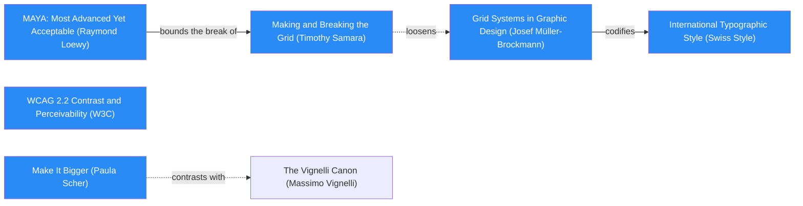
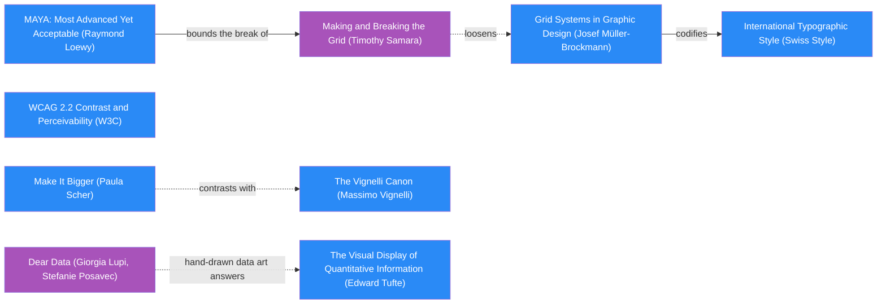

# DESIGN-LOG: shadw-MCP site

Run: DADA, **Adaptive** mode, **Full** run type with a **Landing** move. Bounded by the owner's standing rule: at most 2
WHOLE panel rounds; whatever is still open after that is logged, and the strongest variant ships.

## 1. Traversal Plan

**Brief, in one sentence:** a multi-page site for shadw-MCP whose landing shows, in one bold first-screen graphic, how
an agent with a Shadw API key deploys, watches and rolls back a project, with every figure computed from the server's
own source.

**Mode:** Adaptive. The site serves a public audience: developers and agent builders deciding whether to install the
server. The governing criterion is MAYA (Loewy).

**Lessons read first** (PrometheusIntelligence/dada-lessons): 40–42, the landing must be one bold graphic that
summarizes every page and is complete on the first screen; 44, audit every sentence about the software against a
`file:line`; 45, measure the rendered page, not the source or a capture; 46, a graphic that encodes data is measured
against its data; 47, seat Evidence (Cairo) with a runnable engine; 55, `[hidden]` against `display`; 57, the hero is the
product's own worked example.

### Step 0. Tooling inventory

| Job | Tool used |
|---|---|
| Anchor graph | Mermaid text in this log (no renderer in this session) |
| Frontier | By hand, from the edge lines of `references/anchor-graph.md` |
| Workflow state | The app's task list (`update_plan`) |
| Panel | Sub-agents, one per reference, at most three at a time, filing to `panel/R<n>/` |
| Collect panel | `scripts/collect_panel.py` from the DADA skill |
| Measure | `_src/measure.mjs` driving headless Chrome over the DevTools protocol, plus the app's browser pane |
| Persist | This file |

### Seed (labels verbatim from `references/anchor-graph.md`)

- Stance: `Make It Bigger (Paula Scher)`
- Rules: `Grid Systems in Graphic Design (Josef Müller-Brockmann)` -->|codifies| `International Typographic Style (Swiss Style)`;
  `WCAG 2.2 Contrast and Perceivability (W3C)`
- Breaker: `Making and Breaking the Grid (Timothy Samara)`, bounded by `MAYA: Most Advanced Yet Acceptable (Raymond Loewy)`
  (`maya -->|bounds the break of| samBreak`)
- Counterpoint: `Making and Breaking the Grid (Timothy Samara)` -.->|loosens| `Grid Systems in Graphic Design (Josef Müller-Brockmann)`;
  second dotted edge: `Make It Bigger (Paula Scher)` -.->|contrasts with| `The Vignelli Canon (Massimo Vignelli)`

Chain: `Make It Bigger (Paula Scher)` sets the scale of the one hero figure → `Grid Systems in Graphic Design (Josef
Müller-Brockmann)` -->|codifies| `International Typographic Style (Swiss Style)` for every page → `Making and Breaking the
Grid (Timothy Samara)` breaks that grid once, in the hero, where the agent's session crosses it → `WCAG 2.2 Contrast and
Perceivability (W3C)` is the floor under all of it.

### Pages (multi-page rule) and the landing inventory

| Page | Topic | The figure that stands for it |
|---|---|---|
| `setup.html` | Install and register the server | 1 required variable, `SHADW_API_KEY` |
| `keys.html` | API keys and roles | 4 roles a key can carry |
| `deploy.html` | Deploy and follow the build | the default wait, in seconds |
| `health.html` | Health, logs and status | 3 verdicts |
| `rollback.html` | Deployments, rollback and redeploy | 1 call to roll back |
| `tools.html` | All tools, generated from `src/tools.js` | the tool count |

### Panel (Adaptive, one agent per reference)

`Critic: Provocateur (Debord)`, `Critic: Provocateur (Shklovsky)`, `Critic: Inclusion (Holmes)`, `Critic: Inclusion
(Mace)`, `Critic: Evidence (Cairo)`, `Critic: Usability (Krug)`, `Critic: Formalist (Arnheim)`. Dotted pair: Debord
-.->|attacks smoothness favored by| Krug.

### Frontier (initial)

| Candidate | Reached via (edge label, direction) | From anchor | Status |
|---|---|---|---|
| The relay: the session as one wire crossing every stage tile | loosens (dotted, out) | samBreak | OPEN |
| One 12-column grid for every page | codifies (out) | mb | OPEN |
| One huge computed figure per stage | Make It Bigger (stance) | scher | OPEN |
| The tool matrix: one cell per tool, coloured by what it may do | hand-drawn data art answers (dotted, in) | lupiDear → tufteV | OPEN |
| Vignelli restraint against Scher scale | contrasts with (dotted, out) | scher | OPEN |
| Contrast floor on the gradient | contrast floor constrains (dotted) | wcag | OPEN |
| Claims audit: every behaviour sentence cites `src/*.js:line` | lesson 44 | Critic: Evidence (Cairo) | OPEN |

R0 premortem: none. The repository had no site before this run.

## 2. Decision Records

## Move M1: One grid, one type system, generated from the source  (KEEP-THE-RULE)
Depends on: none
Anchors: Stance `Make It Bigger (Paula Scher)` | Rule `Grid Systems in Graphic Design (Josef Müller-Brockmann)`, `International Typographic Style (Swiss Style)` | Counterpoint `The Vignelli Canon (Massimo Vignelli)` (dotted from Scher)
Intent: every page sits on one 12-column grid with flush-left type in two families (system sans for text, monospace for every identifier, route and number), black ground, Shadw's Turbo Flow ramp used only for the wire and the active state.
Formal argument: the readers are agent builders scanning for routes and tool names; Müller-Brockmann's grid makes the same thing sit in the same place on every page, and the Swiss style's objectivity matches a reference site. Scher's scale is kept for the one figure per section (M3), Vignelli's restraint for everything else.
Alternatives rejected: (a) a docs-framework look (sidebar plus prose): it reads as any other MCP README and gives the hero nowhere to break; (b) Shadw's own glow-dome landing: copying the parent product's hero makes this page a sub-brand ad, not a tool.
Consequence: a reference site that is plain by design; ambition must come from M2 alone. Cost: the generator is code that must be kept with the server.
Fence: not applicable (no rule broken).
Frontier effect: opens M2 (somewhere to break), M4 (generated pages make claims checkable).
Mode field: Advanced pole: none here (this is the acceptable pole's ground). Acceptable pole: `International Typographic Style (Swiss Style)`.

## Move M2: The relay — one agent session as a wire through five stages  (BREAK)
Depends on: M1
Anchors: Breaker `Making and Breaking the Grid (Timothy Samara)` | Counterpoint `Grid Systems in Graphic Design (Josef Müller-Brockmann)` (dotted: samBreak loosens mb) | Rule `MAYA: Most Advanced Yet Acceptable (Raymond Loewy)` bounds the break
Intent: the landing's graphic is the product's own worked example (lesson 57). Five stage tiles on the grid, Setup → Key → Deploy → Watch → Roll back, each with a huge computed figure, the tools that stage calls and a link to its page. One Turbo Flow wire, the agent's session, enters from the left and runs through every tile, crossing the tile borders: the only place the grid is broken. Under it, the tool matrix (M3). Together they summarize all six pages (lesson 41).
Formal argument: claim: the clearest proof an MCP works is the sequence of calls an agent makes. Grounds: the five stages map one-to-one onto the server's 15 tools. Warrant: Samara lets a single element break a grid when the break carries the meaning; here the break is the session, the one thing that crosses every stage.
Alternatives rejected: (a) a terminal transcript as hero: true but small type, and it summarizes one call, not the site; (b) six equal cards: lesson 41 says six cards in a row is not a form; (c) a large logo mark: says nothing about what the server does.
Consequence: the hero must fit 1280 x 800 and 375 x 812 complete (First screen rule). On a phone the five tiles become five rows and the wire runs down the left edge; the tool chips move below the fold to the stage pages.
Fence: the grid exists so a reader finds the same thing in the same place; the wire breaks only the tile borders, never the reading order or the columns.
Frontier effect: opens wire-on-phone, gradient contrast (WCAG), motion and reduced motion.
Mode field: Advanced pole: `Making and Breaking the Grid (Timothy Samara)`. Acceptable pole: `MAYA: Most Advanced Yet Acceptable (Raymond Loewy)` (every tile is still a plain, linked, readable block).

## Move M3: The tool matrix — fifteen cells, coloured by what each tool may do  (BREAK)
Depends on: M2
Anchors: Expression `Dear Data (Giorgia Lupi, Stefanie Posavec)` -.->|hand-drawn data art answers| `The Visual Display of Quantitative Information (Edward Tufte)` | Stance `Make It Bigger (Paula Scher)`
Intent: below the relay, one row of 15 square cells, one per tool, grouped under its stage, with read-only, write and destructive tools drawn as outline, filled and ringed cells, and a legend with the computed counts. The matrix is the Tools page in miniature, and it answers the question an operator asks first: what can this key make the agent do?
Formal argument: the mark is generated from the product's own definition (`annotations` in `src/tools.js`), the way Facet's identity came from its own output; Tufte's data-ink rule keeps it to cells and counts.
Alternatives rejected: (a) a list of tool names: fifteen words cannot be scanned for risk; (b) a pie of read versus write: hides which tool is which.
Consequence: the build must parse `src/tools.js`; a new tool changes the hero automatically.
Fence: not applicable.
Frontier effect: opens the cell-shape channel (colour plus shape, lesson 18), hover/focus labels.
Mode field: Advanced pole: `Dear Data (Giorgia Lupi, Stefanie Posavec)`. Acceptable pole: `The Visual Display of Quantitative Information (Edward Tufte)`.

## Move M4: Every claim about the server cites its line  (KEEP-THE-RULE)
Depends on: M1
Anchors: Critic `Critic: Evidence (Cairo)` | Rule `WCAG 2.2 Contrast and Perceivability (W3C)` (floor for the citation links)
Intent: every sentence that states a limit, a default or a refusal is generated beside a `src/<file>.js:<line>` link, found at build time by searching the source for the code it describes; the build fails if the code is gone. Every figure is written to `site/facts.json` with the procedure that reproduces it.
Formal argument: lesson 44: copy about software written from memory overstates it.
Alternatives rejected: (a) hand-written docs reviewed once: drift is the failure lesson 44 records; (b) no citations: the reader cannot audit.
Consequence: the copy is shorter, and limited to what the code shows.
Fence: not applicable.
Frontier effect: opens the 2g final re-measure.
Mode field: Advanced pole: none. Acceptable pole: `WCAG 2.2 Contrast and Perceivability (W3C)`.

## 3. Panel Reports

### Panel, WHOLE, round R1  (artifact examined: `site/` built from 2f2e114 plus M1–M4; `.dada/panel/R1/*.png`; `.dada/evidence-R1.md`)
| Critic | Anchor used | Observed in the work | Verdict | Requested change |
|---|---|---|---|---|
| Provocateur (Debord) | Society of the Spectacle, theses 1 and 4 | "watches" sells vigilance, but `shadw_project_health` is a snapshot on request; "1 call to roll back" needs a deployment id from `list_deployments`, so it is 2 calls; "HTTP 403" is Shadw's promise, not this code's | OBJECT | "checks", "2 calls", qualify or cite the 403 |
| Provocateur (Shklovsky) | Art as Device (ostranenie) | five stat tiles are the habitual SaaS row; the 15-cell matrix with one hatched cell is the strangest, truest device but is buried at the bottom; the gradient verbs are house dialect | OBJECT | make the matrix dominant, the destructive cell loud; ramp only on the wire; 600 as a duration |
| Inclusion (Holmes) | Mismatch | the first screen never says what MCP is; "verdicts", "promote", "mint" unglossed; each relay link's accessible name is a run-on string including its chips; matrix groups lack roles; "· · Tools" kicker read aloud | OBJECT | an MCP line under the h1; gloss jargon; chips outside the link; group roles; plain kicker |
| Inclusion (Mace) | Universal Design: size and space; perceptible information | focus rings pass; phone cells 18 px at 22 px pitch fail WCAG 2.5.8 (the probe's spacing test was inverted); in forced colours write cells lose their fill and read as read cells | OBJECT | 24 px pitch or non-link cells; forced-colour fills; fix the probe |
| Evidence (Cairo) | How Charts Lie | 15 / 9 / 5 / 1, 4 roles, 600 / 3600 / 40, 3 verdicts, 7 tests all true; `list_deployments` params mis-rendered ("project default 50", `limit` dropped); "1 call" overstated; "HTTP 403" and SHADW_TEAM "inferred from the key" untraceable; health omits the unknown-project error and the unreadable-logs case; one cite off by two lines | OBJECT | fix the param renderer; 2 calls; cite or delete; add the two cases |
| Usability (Krug) | Don't Make Me Think: five-second and trunk tests | site and topics read in five seconds, but the noun "MCP server" is missing; the first action is a small `npm install` at 1280 and absent at 375; tiles don't look clickable; the setup command is cut off at the right | OBJECT | an MCP line; a visible "Set it up" button on the first screen at both sizes; wrap the command |
| Formalist (Arnheim) | Art and Visual Perception: directed tension, skeleton | the composition holds ("600" the structural centre; the empty set-up tile a rest), but the wire is painted over by the tiles and reads as five dots; the matrix groups do not sit under their stages | OBJECT (minor) | raise the wire above the tiles; register each group under its stage |

Statements of meaning: every seat read the landing as a spec sheet of what an agent can do, in order. Artist question: is the five-stage relay the right skeleton? (No seat asked to replace it; Shklovsky asked to subordinate it.) Andon pulled: no. Instrument failure: the second capture of `index-1280.png` was tiled 2 x 2 (headless window smaller than the emulated viewport); five seats saw it. Fixed in `_src/measure.mjs` (`--window-size=1280,900` and a clipped capture), recaptured, and the remaining seats were told (lesson 45).

### Resolutions (R1)

Rival pair: Shklovsky (make the matrix the hero) against Arnheim (the relay is the skeleton; register the matrix to it). Merge, M5: the matrix moves up into the relay's own grid, one group under each stage, cells larger, with the stage-0 slot holding the "Set it up" button Krug asked for. The matrix gains weight and register, the relay keeps the skeleton, and the first action lands where the eye ends.

| Objection | Resolution |
|---|---|
| Debord: "watches" | ADAPT (M5): "checks" |
| Debord + Cairo: "1 call to roll back" | ADAPT (M5): figure becomes 2, "calls to roll back: list, then promote"; "last good" removed |
| Debord + Cairo: "HTTP 403" | ADAPT (M5): the sentence now says the Shadw server decides, not this one; no status code claimed |
| Shklovsky: matrix dominant, destructive loud | ADAPT (M5) via the merge above |
| Shklovsky: ramp only on the wire | ADAPT (M5): headline verbs set in plain ink |
| Shklovsky: 600 drawn as a duration | OVERRULE (MAYA): a proportional wire segment makes one stage longer than the others and breaks the five-column skeleton Arnheim names as the composition's strength; the acceptable pole holds |
| Holmes + Krug: no "MCP" on the first screen | ADAPT (M5): one line under the h1 |
| Holmes: jargon | ADAPT (M5): "promote" and "verdict" glossed where first used |
| Holmes: run-on link names | ADAPT (M5): chips moved outside the link; the link names only step, figure and unit |
| Holmes: group roles; "· · Tools" | ADAPT (M5): groups become labelled lists; kicker "Reference" |
| Mace: phone cell targets | ADAPT (M5): cells are no longer links (a list with screen-reader text); "all 15 tools" is the one link. Probe fixed: it now reports small targets that do have a neighbour within 24 px |
| Mace: forced colours | ADAPT (M5): `forced-color-adjust: none` with CanvasText fills and a Canvas slash |
| Cairo: param renderer | ADAPT (M5): parser splits single-line schemas |
| Cairo: SHADW_TEAM default; health cases; cite | ADAPT (M5) |
| Krug: setup command cut off | ADAPT (M5): `pre` wraps |
| Arnheim: wire hidden | ADAPT (M5): wire above the tile fill (it crosses only the empty band under the step labels) |

## Move M5: Answer R1 — the matrix in the relay's grid, and every claim the code can back  (BREAK, ADAPT of M2, M3, M4)
Depends on: M2, M3, M4
Anchors: Breaker `Making and Breaking the Grid (Timothy Samara)` | Rule `Grid Systems in Graphic Design (Josef Müller-Brockmann)` | Rule `WCAG 2.2 Contrast and Perceivability (W3C)` | Counterpoint `The Vignelli Canon (Massimo Vignelli)` (dotted from Scher: the ramp is withdrawn from the headline)
Intent: the hero becomes one register: five columns, each a stage tile above its own group of tool cells; the wire runs over all five tile borders; the first action sits in column one.
Formal argument: Arnheim's skeleton (five columns) and Shklovsky's strangest device (the cells) were competing for the eye; putting the cells in the skeleton lets each strengthen the other. Every printed claim is now one Cairo verified or one rewritten to what the code does.
Alternatives rejected: (a) matrix as the whole hero (Shklovsky's full request): loses the order of an agent's session, which every seat read as the page's meaning; (b) keep the strip and only enlarge it: still out of register.
Consequence: the phone first screen must absorb a new line and a button inside 812 px.
Fence: the grid exists for findability; the wire still breaks only tile borders.
Frontier effect: phone height budget; R2.
Mode field: Advanced pole: `Making and Breaking the Grid (Timothy Samara)`. Acceptable pole: `WCAG 2.2 Contrast and Perceivability (W3C)` and MAYA.

### Panel, WHOLE, round R2  (artifact examined: `site/` after M5 and the S4 push; `.dada/panel/R2/*.png`; `.dada/evidence-R2.md`)
| Critic | Anchor used | Observed in the work | Verdict | Requested change |
|---|---|---|---|---|
| Provocateur (Debord) | Society of the Spectacle, theses 1 and 4 | all four R1 objections answered ("checks"; "a check you run, not a monitor"; 2 calls; the 403 promise gone); 600 reads as fixed although it is a cap; the band says "/v1 routes" but `list_deployments` calls `GET /deployments` | PASS | "at most (up to 3600)"; "mostly /v1" (non-blocking) |
| Provocateur (Shklovsky) | Art as Device | ramp now only on the wire; cells in the relay with names; the one hatched cell no longer buried; accepts the 600 overrule "only if 600 stays the one monument"; the other numerals are still the loudest marks; the destructive row is the same size as `whoami`; no danger device on the phone | OBJECT | halve 1/4/3/2; a full-width hatched band for `revoke_api_key`; show it on the phone |
| Inclusion (Holmes) | Mismatch | MCP line, short link names, separate tool lists, "Reference" kicker, glosses all present; "promote one" and "mint" remain on the landing; MCP never expanded | PASS | plain verbs; expand MCP once (non-blocking) |
| Inclusion (Mace) | Universal Design | focus visible on every landing control (3 px amber, measured surfaces); no small target left on the phone; desktop chip rows 26 px pass 2.5.8; forced-colour kinds distinct; reduced motion honoured | PASS | drop the 2 px radius on `.btn:focus-visible` (non-blocking) |
| Evidence (Cairo) | How Charts Lie | `npm test` 7/7; every R1 item verified fixed with file:line; all landing figures true; two sentences false: "only the key has no default" (SHADW_TEAM has none either) and "/v1 routes" | OBJECT (minor) | "only the key is required"; "mostly /v1"; cite the 40 log lines |
| Usability (Krug) | Don't Make Me Think | MCP line and a filled "Set it up →" on the first screen at both sizes; five-second and trunk tests pass; the setup command still clips at 1280 (`pre-wrap` only in the phone query) | OBJECT | wrap `pre` in the base rule |
| Formalist (Arnheim) | Art and Visual Perception | the wire is one unbroken 6 px vector at y ≈ 328 across all five borders; cells in register; eye enters at the headline, is pulled right, held by "600", rests on the cells; the button anchors lower left | PASS | none (the ragged divider heights read as a histogram; keep if intended) |

Statements of meaning: a spec sheet of an agent's session, in order, that now says "check" where it once said "watch". Andon pulled: no.

### Resolutions (R2) — the round cap is reached; these are applied and measured, not re-judged by a third round

| Objection | Resolution |
|---|---|
| Cairo: "only the key has no default" | ADAPT (M6): "only the key is required"; the same wording fixed in `facts.json`'s procedure |
| Cairo + Debord: "/v1 routes" | ADAPT (M6): "the same routes (mostly `/v1`)" |
| Cairo: cite the log-tail figure | ADAPT (M6): `src/tools.js` `summarizeBuild` cited on deploy.html |
| Debord: 600 is a cap | ADAPT (M6): sub-line "at most, by default (up to 3600); then state, URL, log tail" |
| Krug: command clipped at 1280 | ADAPT (M6): `white-space: pre-wrap; overflow-wrap: anywhere` in the base `pre` rule; setup-1280 now shows the whole command (two lines) |
| Holmes: "promote one", "mint", MCP | ADAPT (M6): "make an earlier one live again"; "create"; "MCP (Model Context Protocol)" |
| Mace: button focus radius | ADAPT (M6): radius removed from the focus rule |
| Shklovsky: destructive row | ADAPT (M6): `revoke_api_key` is now a full-width hatched amber band with a 1 px amber edge, the only row of its kind |
| Shklovsky: halve 1/4/3/2 | OVERRULE (MAYA, and lesson 42): each tile's figure is that stage's computed fact, and the poster that earned the A gave every topic a huge figure; making four of five small turns the summary into one figure plus captions. Arnheim, the formal seat, passed the current balance. Logged as an open item for the owner |
| Shklovsky: danger device on the phone | DEFERRED (first-screen budget): the phone hero is 710 of 812 px; the destructive row is on keys.html and tools.html; logged as open |

## Move M6: Answer R2 — the last wording, the wrap, the danger band  (KEEP-THE-RULE, ADAPT of M5)
Recorded after the edits, in the same sitting (deviation: the record should precede the move).
Depends on: M5
Anchors: Rule `WCAG 2.2 Contrast and Perceivability (W3C)` | Critic `Critic: Evidence (Cairo)` | Expression `Dear Data (Giorgia Lupi, Stefanie Posavec)` (the band is the destructive cell made larger, from the same annotation)
Intent: close every R2 objection that has a measurable answer; leave the composition alone.
Formal argument: four of seven seats passed; the objections left are sentences, one CSS rule and one emphasis.
Alternatives rejected: (a) a third panel round: past the owner's cap; (b) shrinking four figures: see the OVERRULE.
Consequence: the desktop hero grew from 753 to 782 px of 800 (the deploy sub-line is three lines); still complete.
Fence: not applicable.
Frontier effect: none new.
Mode field: Advanced pole: the danger band (`Dear Data (Giorgia Lupi, Stefanie Posavec)`). Acceptable pole: `WCAG 2.2 Contrast and Perceivability (W3C)`.

### S4 ambition push (logged at the time it was made, before R2)
The boldest Breaker's boldest element, the stage figures, pushed from `clamp(56px, 6.4vw, 92px)` to `clamp(56px, 8.4vw, 116px)`: the computed size at 1280 went from 81.9 to 107.5 px; the relay grew from 399 to 423 px tall; "600" now spans its tile with 0 px overflow inside any tile; the hero bottom moved from 728 to 753 of 800 (complete). The wire went from 4 to 6 px. R2 judged the pushed state.

## Frontier (final)
| Candidate | Reached via (edge label, direction) | From anchor | Status |
|---|---|---|---|
| The relay | loosens (dotted, out) | samBreak | TAKEN (M2, M5) |
| One 12-column grid | codifies (out) | mb | TAKEN (M1) |
| One huge computed figure per stage | Make It Bigger | scher | TAKEN (M2), pushed (S4) |
| The tool matrix | hand-drawn data art answers (dotted, in) | lupiDear | TAKEN (M3), moved into the relay (M5), danger band (M6) |
| Vignelli restraint against Scher scale | contrasts with (dotted, out) | scher | TAKEN (M5: ramp withdrawn from the headline) |
| Contrast floor on the gradient | contrast floor constrains (dotted) | wcag | TAKEN (probe: 0 failures; ramp text removed) |
| Claims audit | lesson 44 | Cairo | TAKEN (M4, M5, M6) |
| Halve the four smaller figures | Shklovsky R2 | — | DEFERRED (OVERRULED; open item for the owner) |
| Danger row on the phone first screen | Shklovsky R2 | — | DEFERRED (phone first-screen budget) |

## 4. Anchor Ledger
| Anchor | Role | Status | Evidence | Replacement or note |
|---|---|---|---|---|
| Make It Bigger (Paula Scher) | Stance | KEEP | figures pushed to 107.5 px; survived Shklovsky's "halve them" (OVERRULED) | — |
| Grid Systems in Graphic Design (Josef Müller-Brockmann) | Rule | KEEP | five-column relay and 12-column bands; survived Arnheim R1 (register), answered by M5 | — |
| International Typographic Style (Swiss Style) | Rule | KEEP | flush-left sans and mono on every page; survived Shklovsky's "habitual SaaS row" | — |
| WCAG 2.2 Contrast and Perceivability (W3C) | Rule | KEEP | 0 contrast failures, 0 small targets, focus visible (Mace R2 PASS) | — |
| Making and Breaking the Grid (Timothy Samara) | Breaker | ADAPT | the wire was hidden behind the tiles (Arnheim R1); raised above the fill (M5) | — |
| MAYA: Most Advanced Yet Acceptable (Raymond Loewy) | Criterion | KEEP | decided two OVERRULEs (600 as a duration; halving the figures) | — |
| The Vignelli Canon (Massimo Vignelli) | Counterpoint | KEEP | ramp withdrawn from the headline (Shklovsky R1) | — |
| Dear Data (Giorgia Lupi, Stefanie Posavec) | Expression | ADAPT | cells moved from a strip into the relay (M5), danger band (M6) | — |
| The Visual Display of Quantitative Information (Edward Tufte) | Expression | KEEP | cells and counts only; Cairo R1 "matrix: truthful" | — |

### 2f. Deletion review
Nothing predates this run except the server and its README. Deleted during the run: the separate 15-cell strip (M5;
its cells now live in the tiles, so the information is kept and the competing second system is gone), the gradient on
the headline verbs (M5), the claims "watches", "1 call", "HTTP 403", "inferred from the key" and "only the key has no
default" (M5, M6). Residual diff for M5: legend counts unchanged (9/5/1); hero bottom 728 → 781 → 728 after the
headline width fix (intended); the phone lost the cells (intended, the first-screen version) and gained the button.

### 2g. Figures the site prints, re-measured at the final state (after the last edit: build, then `_src/measure.mjs`)
| Printed figure | Procedure that reproduces it | Final value | Status |
|---|---|---|---|
| 15 tools | count `server.registerTool(` in `src/tools.js` | 15 | reproducible |
| 9 read-only / 5 write / 1 destructive | annotations RO / WRITE / `destructiveHint: true` | 9 / 5 / 1 | reproducible (the first build printed 0 destructive: parser bug, fixed) |
| 4 roles, default member | `role` enum in `shadw_create_api_key` | 4, member | reproducible |
| 1 key to set | `SHADW_API_KEY` is the only required variable (`src/cli.js` warns without it) | 1 | corrected wording (R2) |
| 6 environment variables | distinct `env.SHADW_*` reads in `src/client.js` | 6 | reproducible |
| 600 s, up to 3600 | `timeout_seconds` default and max in `shadw_deploy` | 600, 3600 | reproducible |
| 40 log lines | `summarizeBuild` default `tail` | 40 | reproducible, now cited |
| 3 verdicts | status strings in `projectHealth` | 3 | reproducible |
| 2 calls to roll back | `list_deployments` then `promote_deployment` | 2 | corrected (R1: was 1) |
| 7 tests | `test(` in `test/server.test.js`; `npm test` 7/7 pass | 7 | reproducible |
| First screen complete | `_src/measure.mjs`, hero bottom vs viewport | 782/800 and 710/812 | measured after the last edit |
Every figure is in `site/facts.json` with its procedure; the build throws if a cited line is gone.

## 5. Stop test
- **S1** Frontier: no OPEN item; two DEFERRED with reasons. Met.
- **S2** A WHOLE round with PASS from every required critic: **not met**. R2 passed 4 of 7; the objections of Cairo
  and Krug are fixed and measured but were not re-judged; Shklovsky's are one ADAPT, one OVERRULE and one DEFERRED.
- **S3** Two quiet WHOLE rounds: **not met** (bounded run: 2 WHOLE rounds by the owner's rule).
- **S4** Ambition push: met, with the measured delta above.
- **S5** Dotted edges: `samBreak -.-> mb` applied (M2), `scher -.-> vignelliCanon` applied (M5), `lupiDear -.-> tufteV`
  applied (M3), `wcag` dotted constraints applied (probe), `crit_prov_debord -.-> crit_use_krug` seated. Met.

The run is **incomplete** by DADA's stop conditions (S2, S3), as the owner's round cap allows. Resume point: a third
WHOLE round with Shklovsky, Cairo and Krug on the M6 state.

## Double loop
The panel worked, and again the decisive defects came from measurement and code-reading, not looking: Cairo found a
parser bug that dropped a parameter and two untraceable sentences; Mace found that my target probe's spacing test was
inverted (it reported compliant targets and hid the failing ones); and five seats were shown a tiled screenshot my
instrument produced on its second run. What failed was the instrument, twice, the same way lesson 45 records. **Process
amendment:** before a panel round, the conductor opens every screenshot handed to the seats (not just the first run's),
and every measuring probe gets one deliberately failing fixture so an inverted test shows itself. **Graph amendment:**
add an edge `c_genchi -->|open every capture handed to the panel| CRITICS` beside lesson 45's "Instrument check" node.

## Compliance Check
- [x] Tooling inventory: §1 table (headless Chrome over DevTools via `_src/measure.mjs`; sub-agents; collector script)
- [x] Mode stated with the reason: §1 (Adaptive, public developer audience)
- [x] Seed with exact labels, two dotted counterpoints, living Frontier: §1, Frontier (final)
- [x] Run type stated (Full with a Landing move); no freeze applies to a new site
- [x] Landing leads with one bold graphic summarizing every page (five stages = five pages, Tools in the legend link), measured complete at 1280 x 800 (bottom 782) and 375 x 812 (bottom 710)
- [x] BREAK moves taken (M2, M3, M5); no quota used
- [~] Decision Records before each move: M1–M5 yes; M6 recorded after its edits (deviation, stated)
- [x] Panel Reports per round from the Adaptive composition, one agent per reference (Debord, Shklovsky, Holmes, Mace, Cairo, Krug, Arnheim), each citing the work; 14 of 14 verdicts filed as files
- [x] Every OBJECT resolved as ADAPT, OVERRULE or DEFERRED, dependents reopened (M2–M4 by M5, M5 by M6)
- [~] WHOLE rounds run (R1, R2); S1, S4, S5 met; S2 and S3 not met (bounded)
- [x] Every figure re-measured at the final state, with its procedure (2g)
- [x] Anchor Ledger complete and the live graph updated
- [x] Double-loop paragraph written; carry-forward in `DESIGN-CARRY-FORWARD.md`
- [x] Final reply states the mode, tools, stop conditions and skips

---

# Run 2: Polish, and the Shadw deploy (2026-10-31)

## 1. Traversal Plan

**Brief, in one sentence:** the site did not deploy to Shadw; make the repository match the owner's static deploy format
so Shadw serves `site/`, and polish what the R0 premortem finds, without reopening run 1's design.

**Mode:** Adaptive (unchanged). **Run type:** Polish: the concept, the relay, the palette, type, page structure and
navigation are frozen; structure, deploy, claims, metadata, accessibility and performance moves are allowed.
**Bound:** the owner's standing rule caps critic rounds; this run plans R0 (premortem) and R1 (judges the fixes), and
logs anything left after R1 rather than convening R2.

**Skill version:** DADA from PrometheusIntelligence/dada at 4f3a8f9, the first run on the seat registry and ledger.

### Step 0. Tooling
| Job | Tool used |
|---|---|
| Choose the panel | `scripts/pick_panel.py --mode adaptive --run-type polish --project shadw-MCP` |
| Brief each seat | the prompt in `seats/<seat>.md`, filled with round, evidence, artifact, words and panel directory only (`.dada/prompts/`) |
| Panel | sub-agents, one per seat, at most three at a time, filing to `.dada/panel/run2-R<n>/` |
| Measure | `_src/measure.mjs`, after `--selftest` (below) |
| Record | `scripts/import_log.py` and `scripts/rate_seats.py` in PrometheusIntelligence/dada |

### Instrument check (new skill rule: every probe has a fixture that must fail)
`node _src/measure.mjs --selftest` builds a page that fails every probe. The first run caught a real defect: on a page
that overflows sideways, the phone emulation zooms out and `innerHeight` became 3,248 px, so a 2,102 px hero read as
"complete". The probe now measures against the emulated device (375 x 812, 1280 x 800). After the fix, all six probes
catch the fixture (overflow, contrast, target spacing, `[hidden]`, smallest text, first screen). Every screenshot
handed to R0 was opened by the conductor first; none was tiled.

### Panel (from the picker, copied with its reasons)
| Seat | Why | Score | Rounds |
|---|---|---|---|
| Critic: Evidence (Cairo) | required by the Polish panel minimum | 0.881 | 47 |
| Critic: Usability (Krug) | required by the Polish panel minimum | 0.800 | 60 |
| Critic: Provocateur (Debord) | required by the Polish panel minimum | 0.765 | 65 |
| Critic: Inclusion (Mace) | rated: shrunk score 0.845 over 61 rounds | 0.857 | 61 |
Dotted pair: Debord -.- Krug. No rotation slot: Polish leaves one flexible seat, and the picker rotates only when two
or more are flexible.

### Seed (unchanged from run 1; the Breaker is frozen)
Stance `Make It Bigger (Paula Scher)`; Rules `Grid Systems in Graphic Design (Josef Müller-Brockmann)`, `WCAG 2.2
Contrast and Perceivability (W3C)`; Breaker `Making and Breaking the Grid (Timothy Samara)`; counterpoint `The Vignelli
Canon (Massimo Vignelli)`. Polish's BREAK is an escalation of the existing device only.

### Frontier (initial)
| Candidate | Reached via | From | Status |
|---|---|---|---|
| The deploy: root `package.json` with a `start` script sends Shadw down the Node lane | owner's report; framework.rs:749-755 | Cairo's duty (run the build) | OPEN |
| R0 objections | premortem | panel | OPEN (after R0) |

## 3. Panel Reports (run 2)

### Panel, WHOLE, round R0  (artifact examined: commit fef13d3 plus the corrected `_src/measure.mjs`; `.dada/evidence-run2-R0.md`; `.dada/panel/run2-R0/*.png`)
| Critic | Anchor used | Observed in the work | Verdict | Requested change |
|---|---|---|---|---|
| Critic: Evidence (Cairo) | How Charts Lie | ran `npm test` (7/7), the build and the measure; every printed figure holds; F1 root `start` script breaks the static deploy; F2 the framework.rs lines are not in this artifact; F3 `measure.mjs` uncommitted; F4 "the same requests as the shadw CLI" uncited; F5 source links name SolutionsAsService | OBJECT | move the server to a subfolder; commit; cite the CLI; org-neutral links |
| Critic: Usability (Krug) | Don't Make Me Think | five-second and trunk tests pass; F2 hollow tool squares read as unticked checkboxes, not links; F3 "600" is the loudest thing; F5 keys lede repeats the create_api_key card; F6 the site cannot be tested because it is not live | OBJECT | make tool names look like links; cut the repeat; move package.json and src/ out of the root |
| Critic: Provocateur (Debord) | Society of the Spectacle, theses 1 and 4 | F1 the canonical address names a site that does not exist (the Node lane); F2 footer "every number is computed" while 30000, HTTP 500 are typed; F3 "One key, one command" then three commands; F4 "7 tests drive these tools" while 4 of 15 are never called; F5 "A key cannot exceed its creator's role" states Shadw's policy as this repo's fact; F6 "instant", "at once" | OBJECT | static root; compute or narrow; "three commands"; "N of 15"; attribute to Shadw; drop "instant" |
| Critic: Inclusion (Mace) | The Principles of Universal Design, P4, P5, P7 | focus passes after a real Tab press; 2.5.8 passes; F1 in forced colours the current-page cue (colour plus box-shadow) disappears; F2 buttons lose their fill and outline; F5 no forced-colours capture | OBJECT | underline `aria-current` and border buttons in forced colours; capture forced colours |

Statements of meaning: a working reference site that cannot be reached. Three of four seats found the deploy defect
independently (Cairo F1, Krug F6, Debord F1). Andon pulled: no.

### Resolutions (R0)
| Finding | Resolution |
|---|---|
| Cairo + Krug + Debord: root `package.json` start script sends Shadw down the Node lane | ADAPT (M7): the server moves to `server/`; the root holds only `index.html`, `vercel.json`, `site/` and the generator in `_src/` |
| Cairo: framework.rs facts not in the artifact | ADAPT (M7): the evidence and the log cite them at PrometheusIntelligence/shadow 2522715 |
| Cairo: `measure.mjs` uncommitted | ADAPT (M7): committed with the run; R1's evidence names the commit |
| Cairo: "the same requests as the shadw CLI" uncited | ADAPT (M8): linked to `crates/shadw-cli/src/client.rs` in dywongcloud/shadow |
| Cairo: links name SolutionsAsService | OVERRULE: GitHub redirects a transferred repository's links and a mirror leaves the original in place, while repo-relative links cannot reach source lines from a site that deploys only `site/`; the links stay absolute |
| Debord: footer "every number is computed" | ADAPT (M8): the request timeout (30000) and the probe's HTTP threshold (500) are now computed from the source and listed in `facts.json` |
| Debord: "One key, one command" | ADAPT (M8): "One key, three commands" |
| Debord: "7 tests drive these tools" | ADAPT (M8): the build counts the tools the tests call and prints it |
| Debord: "A key cannot exceed its creator's role" | ADAPT (M8): the tool description attributes it to the Shadw server, and keys.html cites hive-cloud's refusal |
| Debord: "instant", "at once" | ADAPT (M8): removed from the tool description and rollback.html |
| Krug: tool squares read as checkboxes | ADAPT (M9): tool names underlined as links; the kind squares stay (the shape channel Mace asked for in run 1) |
| Krug: keys lede repeats the card | ADAPT (M9): the lede keeps only what the card does not say |
| Krug: "600" is the loudest thing | DEFERRED (out of run type: the stage figures are run 1's frozen Breaker) |
| Mace: forced-colours current page and buttons | ADAPT (M9): `aria-current` underlined and buttons bordered in forced colours; a forced-colours capture added to the measure |

## Move M7: The repository root holds only the static site  (KEEP-THE-RULE)
Depends on: none (structure, outside the frozen design)
Anchors: Rule `Grid Systems in Graphic Design (Josef Müller-Brockmann)` (the same thing in the same place, here for the deploy) | Critic `Critic: Evidence (Cairo)`
Intent: Shadw's detector sees no `package.json` at the root, finds `index.html` and `vercel.json` (`outputDirectory: site`), and serves `site/` as static.
Formal argument: framework.rs:749-755 (PrometheusIntelligence/shadow 2522715) sends any root `package.json` with a `start` script to the `node` preset before the static fallback, and `"framework": null` is not an override (vercel_config.rs:19). The owner's rule already says the root holds only the static format.
Alternatives rejected: (a) drop the `start` script: the next dependency that matches a framework sends it back to Node, and the package still sits at the root against the rule; (b) a `shadw.yml` override: not in Dylan's main yet, so live nodes may not read it.
Consequence: install becomes `cd shadw-MCP/server && npm install`; the MCP command path gains `server/`; every source citation on the site moves to `server/src/...`.
Fence: npm users expect `package.json` at a repository root; the README says where it is.
Frontier effect: the site and the server can deploy and publish independently.
Mode field: Advanced pole: none. Acceptable pole: the owner's deploy rule.

## Move M8: Every claim the code can back, and only those  (KEEP-THE-RULE)
Depends on: M7 (citation paths)
Anchors: Critic `Critic: Provocateur (Debord)`, `Critic: Evidence (Cairo)` | Rule `WCAG 2.2 Contrast and Perceivability (W3C)` (floor for the citation links)
Intent: the footer's promise becomes true: every default and limit printed is computed; claims about Shadw's server are attributed and cited to Shadw's code.
Alternatives rejected: (a) narrow the footer to "counts": weaker than making the claim true; (b) delete the role sentence: an agent needs to know why a mint can be refused.
Consequence: two more figures in `facts.json`; the tools page states test coverage honestly.
Fence: not applicable.
Frontier effect: none.
Mode field: Advanced pole: none. Acceptable pole: `Critic: Provocateur (Debord)`'s claims check.

## Move M9: Links that look like links, and forced colours that keep their cues  (BREAK as escalation: the tool cells, run 1's M3 device, gain a link affordance)
Depends on: M5 (run 1)
Anchors: Expression `Dear Data (Giorgia Lupi, Stefanie Posavec)` (the cells) | Rule `WCAG 2.2 Contrast and Perceivability (W3C)`
Intent: each tool name in a stage tile is underlined like the inline links; in forced colours the current page is underlined and buttons keep a border.
Alternatives rejected: (a) replace the kind squares with dots: Mace's run-1 shape channel would weaken; (b) arrows after each name: noise in a list of 15.
Consequence: one more line of ink per chip; measured first screen must still be complete.
Fence: the squares exist so kind survives without colour; they stay.
Frontier effect: forced-colours capture becomes part of the measure.
Mode field: Advanced pole: the cells as links. Acceptable pole: WCAG.

### Panel, WHOLE, round R1  (artifact examined: commit b1620b0; `.dada/evidence-run2-R1.md`; `.dada/panel/run2-R1/*.png`, including the forced-colours captures)
| Critic | Anchor used | Observed in the work | Verdict | Requested change |
|---|---|---|---|---|
| Critic: Evidence (Cairo) | How Charts Lie | reran `npm test` (7/7), the build and the measure herself; every figure holds against `server/src`; no root `package.json`; `measure.mjs` committed; the CLI is cited; F4 source links on `blob/main` drift with the next edit, and the client.rs link is unpinned | PASS | pin source links to a commit (not blocking) |
| Critic: Usability (Krug) | Don't Make Me Think | five-second and trunk tests pass; tool names now read as links; the static root answers R0 F6; F4 the keys lede still repeats the headline and the card; "600" still loudest (accepted as frozen) | OBJECT | cut the keys lede to the roles and the citations |
| Critic: Provocateur (Debord) | Society of the Spectacle, theses 1 and 4 | all six R0 objections answered (static root measured, three commands, 7 of 15, the role rule attributed and cited, "at once" gone); F2 revoke "stops authenticating at once" is the server's timing again; F3 the footer's "every number" while 1h, 30m, 24h, 7d and 0.1.0 are not in `facts.json` | OBJECT | drop "at once"; add the enum and version or narrow the footer |
| Critic: Inclusion (Mace) | The Principles of Universal Design, P4, P7 | both R0 objections answered and visible in the forced-colours captures; kind squares keep their shape channel; 2.5.8 passes; F6 the chip underline in `var(--line)` is faint | PASS | optional: a brighter underline |

Andon pulled: no. Two of four PASS. The round cap is reached (R0 and R1); what follows is applied and measured, not
re-judged.

### Resolutions (R1)
| Finding | Resolution |
|---|---|
| Krug: keys lede repeats the headline and the card | ADAPT (M10): the lede is the four role names and their two citations |
| Debord: revoke "stops authenticating at once" | ADAPT (M10): "at once" removed from the tool description (`server/src/tools.js`, commit 9eb38a6) |
| Debord: footer "every number" | ADAPT (M10): the range enum and the version join `facts.json`, and the footer says "every count, default, limit and version" |
| Mace: faint chip underline | ADAPT (M10): `var(--mute)` |
| Cairo: source links on `main` drift | ADAPT (M10): `build.mjs` pins every source link to the commit that last changed `server/` and refuses to build while `server/` is uncommitted; Dylan's client.rs link is pinned to 9f7db47. While doing it, the conductor found that every tool card's source link still pointed at `blob/main/src/tools.js`, a path the move had emptied: a broken link on 15 cards that no seat reported. The pinned links replace it; 44 of 44 checked against `git show` |

## Move M10: Answer R1, and pin the evidence  (KEEP-THE-RULE)
Recorded after the edits, in the same sitting (deviation, as in run 1's M6).
Depends on: M7, M8, M9
Anchors: Critic `Critic: Evidence (Cairo)`, `Critic: Provocateur (Debord)`, `Critic: Usability (Krug)`, `Critic: Inclusion (Mace)` | Rule `WCAG 2.2 Contrast and Perceivability (W3C)`
Intent: close every R1 finding that has a measurable answer; make every source line the site cites a permanent address.
Alternatives rejected: (a) a third round: past the cap; (b) leave links on `main`: they drift silently.
Consequence: a site build now needs `server/` committed first; that is the point.
Fence: not applicable.
Frontier effect: none new.
Mode field: Advanced pole: none. Acceptable pole: the claims and access checks.

## Frontier (final, run 2)
| Candidate | Status |
|---|---|
| The Shadw deploy | TAKEN (M7), measured with Shadw's detector: `node` before, `static` after |
| R0 claims, access and link findings | TAKEN (M8, M9) |
| R1 findings | TAKEN (M10) |
| "600" is the loudest figure (Krug R0, R1) | DEFERRED (out of run type: run 1's frozen Breaker; Krug accepted it in R1) |
| A live check of `https://shadw-mcp.shadw.app/` | DEFERRED (the owner deploys; nothing here deploys) |

## 4. Anchor Ledger (run 2)
| Anchor | Role | Status | Evidence |
|---|---|---|---|
| Grid Systems in Graphic Design (Josef Müller-Brockmann) | Rule | KEEP | applied to the repository's own layout: the same thing in the same place, so Shadw finds the site |
| WCAG 2.2 Contrast and Perceivability (W3C) | Rule | KEEP | forced-colours cues added; 0 failures at both widths; survived Mace R0 |
| Dear Data (Giorgia Lupi, Stefanie Posavec) | Expression | KEEP | the cells became links without losing their shape channel; survived Krug R0 ("checkboxes") |
| Making and Breaking the Grid (Timothy Samara) | Breaker | KEEP (frozen) | untouched by run 2; Krug's "600" deferred |

### 2f. Deletion review (run 2)
Deleted: the root `package.json`'s place at the root (moved, not deleted), "instant", "at once" (twice), the
duplicated keys lede, the claim that every number is computed (narrowed to what is). Residual diff for M7: the site's
printed figures are unchanged (15, 9/5/1, 4, 600/3600, 40, 3, 2, 7, 6); citation paths gained `server/`; the install
command gained `/server`; the measured first screen is unchanged (782 and 710).

### 2g. Final-state figures (after the last edit: build at 9eb38a6, then `_src/measure.mjs`, after `--selftest`)
| Printed figure | Procedure | Final value | Status |
|---|---|---|---|
| 15 tools; 9 / 5 / 1 | `registerTool` calls; annotations | 15; 9 / 5 / 1 | reproducible |
| 7 tests call 7 of 15 tools | `test(` and distinct `call("shadw_…")` in `server/test/server.test.js`; `npm test` 7/7 | 7, 7 | corrected in R0 (was "drive these tools") |
| 30000 ms; HTTP 500 | `SHADW_TIMEOUT_MS` fallback; `probe()` threshold | 30000; 500 | now computed (Debord R0) |
| 1h default; 30m, 24h, 7d | `shadw_project_health` range enum | same | now in `facts.json` (Debord R1) |
| 0.1.0 | `server/package.json` version | 0.1.0 | now in `facts.json` (Debord R1) |
| First screen | measure | 782/800, 710/812 | measured after the last edit |
| Source links | `git show <sha>:<path>` for each pinned link | 44 of 44 resolve | measured |
| Shadw's choice of preset | `fluid_build::framework::detect` | `static` (was `node`) | measured with Shadw's own code |

## 5. Stop test (run 2)
- **S1** Met: no OPEN item; two DEFERRED with reasons.
- **S2** Not met: R1 passed 2 of 4 (Cairo, Mace); Krug's and Debord's objections are answered by M10 and measured but not re-judged.
- **S3** Not met (Polish needs one quiet WHOLE round after the last move; bounded to R0 and R1 by the owner's rule).
- **S4** Polish push: the refinement with the largest measured effect is the static root, which moves Shadw's choice of preset from `node` to `static`. It was measured with Shadw's own code rather than declared.
- **S5** Met: run 1's dotted edges are unchanged; Debord -.- Krug sat.

Run 2 is **incomplete under the bound** (S2, S3). Resume point: one WHOLE round with Krug and Debord on commit
9eb38a6 or later.

## Double loop (run 2)
The new skill's first run worked where it was designed to. The picker seated the four seats the record supports. The
self-test caught an instrument defect before the panel saw a number: the zoomed-out viewport made a 2,102 px hero read
as "complete". Three of four seats found the deploy defect independently, from the evidence file and the owner's rule.
What failed was the conductor's own path rewrite. A regex excluded paths preceded by `/`, so 15 tool-card links kept
pointing at `blob/main/src/tools.js` after the move. No seat clicked a link; the pinning move found it. **Process
amendment:** after any move that relocates files, the measuring script resolves every source link it prints (here,
`git show <sha>:<path>`), and a link check joins the measurement checklist's probes as "resolves", not just
"internal".

## Human grade (run 2)

| Date | Grade | Words (verbatim) | What it most likely rewards |
|---|---|---|---|
| 2026-10-31 | **A** | "okay a design very good rcord that success" | The deploy defect found by three seats and the fix measured with Shadw's own detector, plus a record that ties every claim to the code. |
